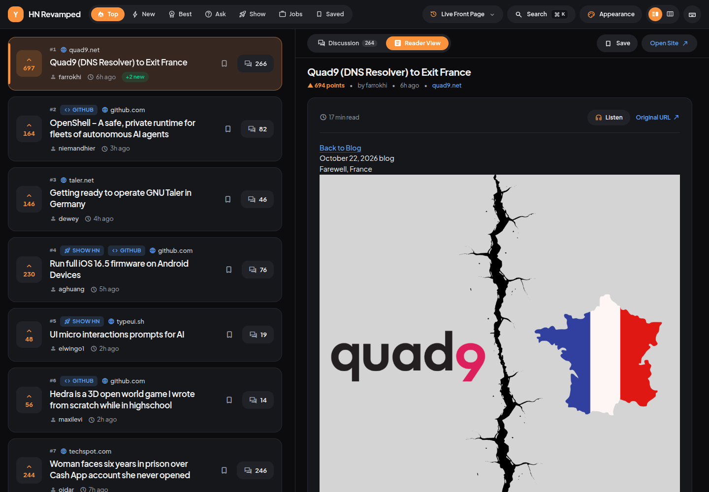
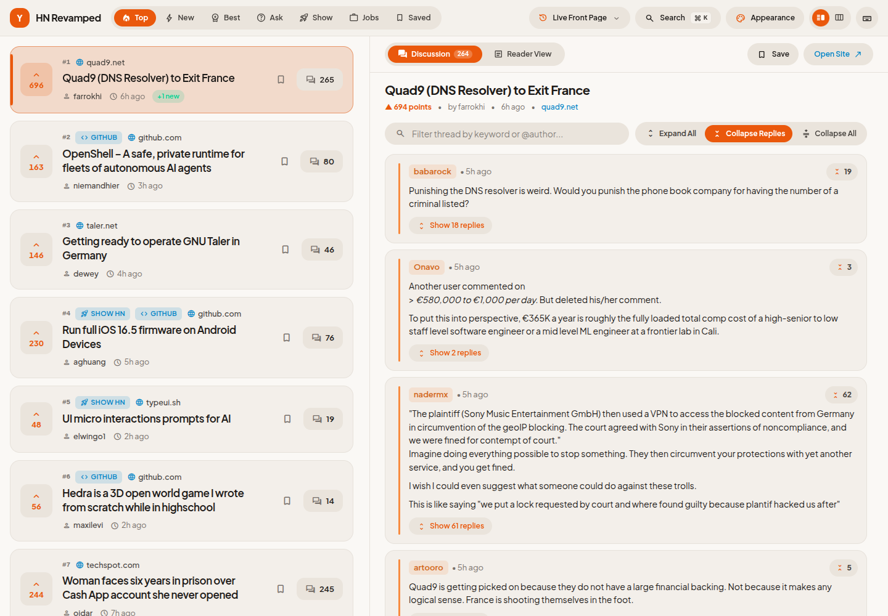
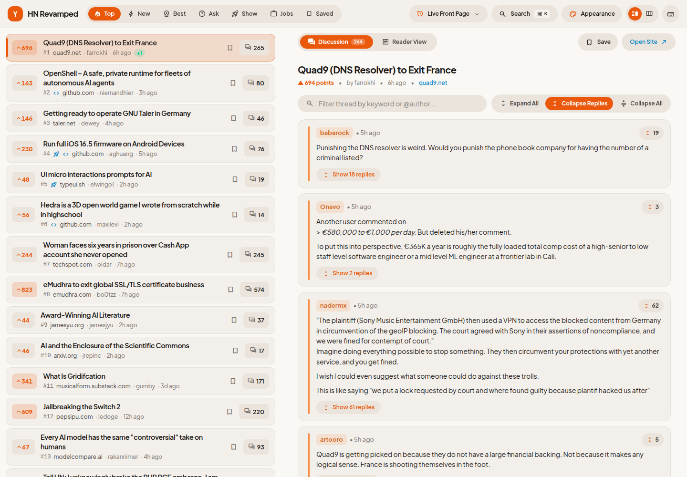
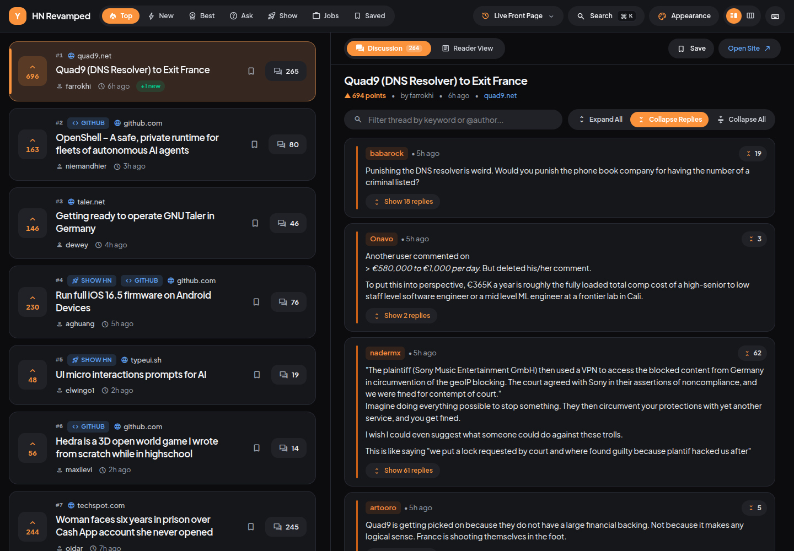
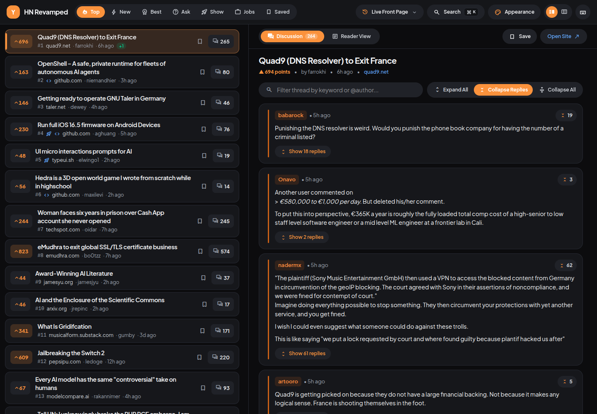
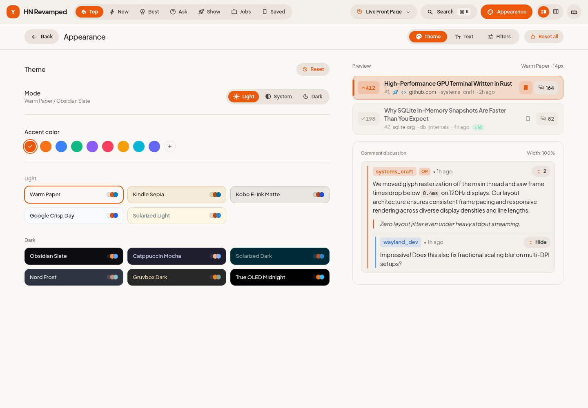
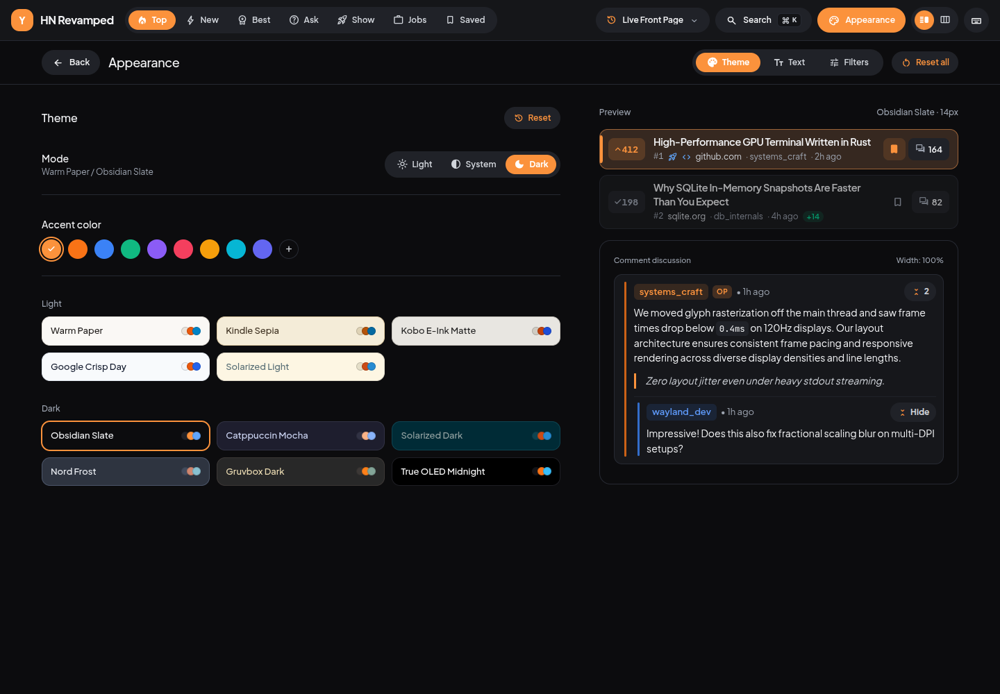
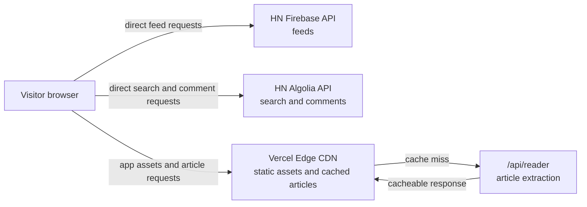

<div align="center">
  
  <h1>HN Revamped</h1>
  <p>A fast, Google Material-inspired modern web client for Hacker News featuring dual-pane reading, e-reader themes, front-page time travel, and a paragraph-synced audio reader.</p>

  <p>
    <a href="https://hn-revamped.vercel.app">
      
    </a>
  </p>
</div>

---

HN Revamped is an opinionated, distraction-free web client for Hacker News built with Next.js 15, React 19, and Tailwind CSS. It connects directly to the official Firebase and Algolia Hacker News APIs to provide real-time feed updates, instant search, full-depth nested comment trees, and reading utilities without tracking or third-party bloat.

## Features

### 🧭 Adaptive Dual-Mode Workspace

- **Split-Pane Layout:** Continuous feed browsing on the left with instant inline previews of comment threads and readable articles on the right.
- **Zen Focus Mode:** One-click distraction-free reading pane that collapses the feed rail for deep comment reading and long-form articles.
- **Deep-Link State:** Clean URL synchronization (`?story=<id>`) with full browser history integration and Back/Forward navigation support.

### 🎨 11 E-Reader & Code Themes

- Comprehensive color palettes built with strict CSS variables to match ambient lighting environments:
  - **E-Reader:** Warm Paper, Kindle Sepia, Kobo Matte, Crisp Day.
  - **Developer:** Obsidian Slate, Catppuccin Mocha, Solarized Dark, Solarized Light, Nord Frost, Gruvbox Dark, OLED Midnight.
- Native CSS variable engine with persistent storage in `localStorage`.
- Configurable typography, adjustable base font sizing, and custom UI density.

### ⚡ Unified Real-Time Data Engine

- **Direct Client Streaming:** Front-page feeds (Top, New, Best, Ask, Show, Launch, Jobs) streamed directly from the official Hacker News Firebase API.
- **Algolia Search & Nested Trees:** Single-request nested comment trees, instant search modal (`⌘K`), and Front-Page Time Travel presets (All-Time Top, 2024, 2023, 2020, 2015, 2010).

### 📖 In-App Article Reader

- Server-side article extraction powered by `@mozilla/readability` and `linkedom`.
- Strict HTML sanitization via `isomorphic-dompurify`.
- Built-in fallback cards for non-standard web media, including YouTube video players, GitHub repositories, and PDF documents.

### 🎧 Paragraph-Synced Audio Reader

- System voices via `window.speechSynthesis` remain the default.
- Optional browser-local Piper, Kokoro q4, and Supertonic voices run inference in dedicated workers. Selecting a local voice downloads only its own engine and model; the reader never starts one merely by opening an article.
- Code-aware content parsing skips `<pre>` blocks and raw URLs. The paragraph stepper highlights and scrolls the spoken text, with playback speed from 1× to 2×.
- The voice dropdown uses `Provider: Voice` labels. A one-paragraph lookahead reduces gaps without synthesizing the whole post.

### 🧵 Comment Folding & Reading Management

- Color-coded comment depth indents with customizable thread collapse modes (Collapse Replies vs. Fold Thread).
- Visited story tracking with semantic link states.
- Client-side bookmarks and reading history stored locally on device.
- Full Vim-style keyboard shortcuts (`j`/`k`, `o`, `c`, `r`, `b`, `?`).

## 🖼️ Card Density & Themes

<table>
  <tr>
    <th>Warm Paper · Comfortable</th>
    <th>Warm Paper · Compact</th>
  </tr>
  <tr>
    <td></td>
    <td></td>
  </tr>
  <tr>
    <th>Obsidian Slate · Comfortable</th>
    <th>Obsidian Slate · Compact</th>
  </tr>
  <tr>
    <td></td>
    <td></td>
  </tr>
</table>

## 🎛️ Appearance Studio

<table>
  <tr>
    <th>Warm Paper · Light</th>
    <th>Obsidian Slate · Dark</th>
  </tr>
  <tr>
    <td></td>
    <td></td>
  </tr>
</table>

---

## Architecture & Edge Optimizations



- **Zero-Compute Feeds:** All feed queries, pagination, search, and comment trees fetch directly from Firebase and Algolia from the client's browser, consuming zero server compute.
- **Edge CDN Caching:** The `/api/reader` endpoint serves extracted articles with `s-maxage=86400, stale-while-revalidate=604800` headers. Once an article is extracted, Vercel's Edge CDN caches the response globally to eliminate duplicate serverless function invocations.
- **Crawler Guard:** `public/robots.txt` disallows automated scraping on `/api/` to safeguard serverless quotas.

---

## Run Locally

### Prerequisites

- Node.js 20.x or newer
- pnpm 11+

### Installation

```bash
# Clone the repository
git clone https://github.com/lalitmee/hn-revamped.git
cd hn-revamped

# Install dependencies
pnpm install --frozen-lockfile

# Start development server
pnpm dev
```

Open [http://localhost:3000](http://localhost:3000) in your browser.

---

## Reader voice build flags

All three optional engines are enabled by default. To turn off one engine, set its respective build-time variable to `false` in the production environment and **rebuild/redeploy**:

- `NEXT_PUBLIC_ENABLE_PIPER_TTS=false`
- `NEXT_PUBLIC_ENABLE_KOKORO_TTS=false`
- `NEXT_PUBLIC_ENABLE_SUPERTONIC_TTS=false`

Each flag is independent. A disabled engine is absent from the voice selector and its worker, runtime, and model are never loaded by the browser. These Next.js public variables are frozen into the client bundle at build time; changing them without a rebuild does not affect an existing deployment. No extra server route is used. Piper voice weights and Supertonic weights are fetched directly from pinned Hugging Face revisions. Their WASM assets are fetched from version-pinned CDN URLs. Supertonic's download is approximately 398 MB, so test it on a suitable connection. Model licensing is separate from this app's MIT license (Supertonic weights: OpenRAIL-M).

## Development Checks

Always verify tests, types, and production builds before committing changes:

```bash
# Run unit and integration tests (Vitest)
pnpm test

# Validate TypeScript types
pnpm typecheck

# Verify optimized production build
pnpm build

# Run local production server
pnpm start
```

---

## Keyboard Shortcuts

Press `?` anywhere in the app to display the keyboard shortcuts modal:

| Key               | Action                              |
| :---------------- | :---------------------------------- |
| `j` / `k`         | Navigate down / up story feed       |
| `Enter` / `Space` | Select and open story detail        |
| `o`               | Open external article in new tab    |
| `c`               | Focus Comments tab                  |
| `r`               | Focus Reader tab                    |
| `b`               | Toggle bookmark for selected story  |
| `z`               | Toggle Zen mode / Split-pane mode   |
| `⌘K` / `Ctrl+K`   | Open Algolia search & time-travel   |
| `?`               | Toggle shortcuts modal              |
| `Esc`             | Close active modal / return to feed |

---

## Project Documentation

- [Design Specification](docs/superpowers/specs/2026-10-22-hn-revamped-design.md)
- [Implementation Plan](docs/superpowers/plans/2026-10-22-hn-revamped.md)
- [Release Notes](docs/releases/0.1.0.md)

---

## License

Distributed under the [MIT License](LICENSE). Copyright © 2026 Lalit Kumar.
