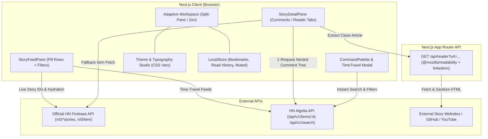

# HN Revamped — Modern Web Client Design Specification

**Date:** 2026-10-22

**Project:** `hn-revamped`

**Stack:** Next.js (App Router), TypeScript, Tailwind CSS, Google Material Symbols Rounded, `@mozilla/readability`

---

## 1. Overview & Vision

Classic Hacker News (`news.ycombinator.com`) features exceptional community discussions and curated technical links, but suffers from a 1990s visual interface: cramped 10pt text, full-page reloads between feeds and comments, poor visual hierarchy in deeply nested threads, no dark or e-reader themes, no read-tracking, and no built-in article reader.

**HN Revamped** is a fast, distraction-free, power-user web client for Hacker News inspired by the best traits of *HackerWeb*, *Modern HN*, *Apollo*, *Readwise Reader*, *Linear*, and *Google Material Design 3*. It combines instant responsiveness with effortless typography, thoughtful semantic link states, Google Material Symbols iconography, an adaptive Split-Pane / Zen workspace, and a curated multi-source Theme Studio.

---

## 2. Core User Experience & Feature Set

### 2.1 Adaptive Dual-Mode Workspace

1. **Split-Pane Master-Detail Mode (Default on Desktop `>= 1024px`):**
   - **Left Pane (`42%` width, resizable/collapsible):** Displays the active story feed (`Top`, `New`, `Best`, `Ask HN`, `Show HN`, `Jobs`, or `Saved`). Scrolling is independent so users never lose their place in the feed.
   - **Right Pane (`58%` width):** Displays the currently selected story's **Discussion Thread** or **Built-in Article Reader View**, switchable via a top segmented control or the `r` keyboard shortcut.
2. **Centered Zen Focus Mode (1-Click / `z` Shortcut Toggle & Mobile Default):**
   - Collapses the split view into a single, centered editorial column (`max-width: 760px` container, customizable reading measure `55ch–80ch`) for deep, distraction-free reading of 500+ comment threads or long-form articles.

### 2.2 Structured Story Pill Rows

Each story in the feed is rendered as a scannable, well-spaced Google Material-inspired tonal surface card with three clear visual zones:

1. **Left Zone — Upvote & Heat Badge:**
   - Displays the point score with a `keyboard_arrow_up` Material Symbol inside a rounded tonal container (`48px × 48px`).
   - Tonal intensity scales subtly with story heat (`< 100 pts` muted slate/amber, `100–300 pts` warm orange, `300+ pts` vibrant flame orange).
   - Stories already read switch to a subtle checkmark (`check`) and dimmed opacity (`60%`).
2. **Center Zone — Typography & Metadata:**
   - **Smart Category & Content Pills:** Automatically detects and badges `Show HN` (`rocket_launch`), `Ask HN` (`help`), `Launch HN` (`flag`), `[PDF]` (`picture_as_pdf`), `[Video]` (`play_circle`), and `GitHub` (`code`).
   - **Headline:** `17px–18px` medium-bold headline with `1.4` line-height and generous spacing.
   - **Metadata Subline:** Favicon + domain name (`language`), author handle (`person`), relative timestamp (`schedule`), and an emerald delta badge (`+18 new`) when new comments have been posted since the user last opened the thread.
3. **Right Zone — Comment Action Pill:**
   - Large clickable pill with the `forum` Material Symbol and comment count.

### 2.3 Color-Coded Comment Tree & Thread Navigation

1. **6-Level Cycling Color Guide Bars:**
   - Nested replies use distinct, harmonious vertical guide bars (`3px` width) cycling through 6 semantic depth colors:
     - Depth 0 (Root): Orange (`#F97316`)
     - Depth 1: Sky Blue (`#3B82F6`)
     - Depth 2: Emerald (`#10B981`)
     - Depth 3: Violet (`#8B5CF6`)
     - Depth 4: Amber (`#F59E0B`)
     - Depth 5+: Cyan (`#06B6D4`)
2. **One-Click Full-Bar Collapse:**
   - Clicking anywhere along a comment's vertical guide bar (or header) collapses the entire branch into a compact 1-line summary bar showing the author, a snippet of the first line, and a `+N children` pill badge.
3. **Thread Power Controls:**
   - **Collapse All Replies (`unfold_less`):** Instantly collapses all child comments so the user can scan top-level root thoughts first, expanding only interesting sub-threads.
   - **In-Thread Search & Filter:** Instant filter input at the top of the discussion pane to highlight and filter comments by keyword or author (e.g., filter to `OP` responses).
   - **OP & Author Highlighting:** Original Poster comments feature a prominent `OP` tonal badge next to their username.
   - **Floating Root Jumper:** Quick floating action button (`keyboard_double_arrow_down` / `J` & `K` keys) to jump smoothly between root comments.

### 2.4 Built-In Distraction-Free Article Reader View

- Clicking the **Article Reader (`article`)** tab in the detail pane extracts and renders the linked article's body directly inside HN Revamped using the user's active theme, font family, font size, and line width.
- Includes estimated reading time (`schedule 5 min read`), lead image, clean headings, formatted code blocks, and a top link to open the original URL (`open_in_new`).
- **Intelligent Content Fallbacks:**
  - **YouTube URLs:** Renders a responsive privacy-enhanced YouTube embed right above the discussion.
  - **GitHub Repository URLs:** Renders a structured repository summary card + README preview.
  - **PDFs / Anti-Scrape Sites:** Renders a clean fallback card explaining the content type with a 1-click button (`o`) to open the original tab.

### 2.5 `⌘K` Command Palette, Instant Search & Front-Page Time Travel

1. **`⌘K` / `/` Universal Search & Command Modal:**
   - Powered by the Algolia HN Search API.
   - Instant debounced search across all Hacker News stories and comments.
   - Filter pills: `Type: Stories | Comments | Ask | Show`, `Sort: Relevance | Points | Date`, `Time: 24h | Past Week | Past Month | Past Year | All Time`.
   - Also provides quick keyboard access to switch themes, toggle Split/Zen mode, and manage muted filters.
2. **Front-Page Time Travel (`history`):**
   - Date selector in the header allowing users to view the top HN stories from **Yesterday**, **Last Week**, **Last Month**, **This Day in History (1, 5, 10 years ago)**, or **Any Custom Date**.

### 2.6 Local Bookmarks, Read History & Muted Filters

- **Read History:** Automatically marks opened stories as read, dims them in the feed (with a toggle to hide read stories completely), and stores the comment count at visit time to compute `+N new` comment badges on return visits.
- **Bookmarks (`bookmark`):** Save both stories and individual insightful comments into a local **Saved** collection with search and JSON export/import.
- **Muted Keywords & Domains (`filter_alt_off`):** Users can mute specific keywords in titles or specific domains so noisy topics are cleanly hidden from their feed.

---

## 3. Google-Inspired Design System, Links & Theme Studio

### 3.1 Google Material Symbols & Tonal Hierarchy

- **Iconography:** Uses Google's variable `Material Symbols Rounded` font (`opsz 20..24`, `wght 400..600`, `FILL 0..1`). Active/selected states transition `FILL` from `0` to `1`.
- **Tonal Surface Architecture:** Follows Material Design 3 tonal elevation principles rather than heavy drop shadows:
  - `--bg-canvas`: Primary page background
  - `--bg-surface-1`: Story card / comment container surface
  - `--bg-surface-2`: Elevated pills, code blocks, header bar, and hover states
  - `--bg-surface-active`: Selected story row tonal highlight
  - `--border-subtle`: Low-contrast hairline divider (`1px solid`)

### 3.2 Thoughtful Semantic Link System

Every theme defines four explicit link tokens to maximize scannability in link-heavy technical threads:

1. **Unvisited External Links (`--link-unvisited`):** High-clarity sky/ocean blue (`#0284C7` in light themes, `#60A5FA` in dark themes) with `text-underline-offset: 3px`, `35%` underline opacity that transitions to `100%` on hover, and a subtle trailing `north_east` icon.
2. **Visited External Links (`--link-visited`):** Distinct muted violet/lavender (`#7C3AED` in light themes, `#A78BFA` in dark themes) so users immediately recognize links they have already explored.
3. **Internal HN Links (`news.ycombinator.com/item?id=...`):** Automatically parsed and rendered as interactive tonal pills (`forum HN #410923`) that open the referenced story or comment directly inside HN Revamped without leaving the app.
4. **User Mentions & Domain Links:** Styled with subtle secondary tonal pills.

### 3.3 Multi-Source Theme & Typography Studio

Accessible via the header `palette` / `text_fields` button, with zero-flash persistence:

| Category | Theme Name | Canvas (`--bg-canvas`) | Surface (`--bg-surface-1`) | Primary Ink (`--text-primary`) | Accent (`--accent`) | Unvisited Link (`--link-unvisited`) | Visited Link (`--link-visited`) |
| :--- | :--- | :--- | :--- | :--- | :--- | :--- | :--- |
| **Reader Light (Default)** | **Warm Paper** *(Readwise/Instapaper)* | `#FAF8F5` | `#F3EFEA` | `#1C1917` | `#EA580C` | `#0284C7` | `#7C3AED` |
| **Reader E-Book** | **Kindle Sepia** | `#F4ECD8` | `#EAE0C8` | `#3B2E1E` | `#B45309` | `#0369A1` | `#6D28D9` |
| **Reader E-Ink** | **Kobo Matte** | `#E8E6E1` | `#DDDAD3` | `#1F1F1F` | `#C2410C` | `#1D4ED8` | `#6D28D9` |
| **Reader Day** | **Google Crisp Day** | `#F8FAFC` | `#FFFFFF` | `#0F172A` | `#EA580C` | `#2563EB` | `#7C3AED` |
| **Reader Dark (Default)** | **Obsidian Slate** | `#0C0C0E` | `#16171B` | `#F3F4F6` | `#FB923C` | `#60A5FA` | `#A78BFA` |
| **Code Dark** | **Catppuccin Mocha** | `#1E1E2E` | `#181825` | `#CDD6F4` | `#FAB387` | `#89B4FA` | `#CBA6F7` |
| **Code Dark** | **Solarized Dark** | `#002B36` | `#073642` | `#93A1A1` | `#CB4B16` | `#268BD2` | `#6C71C4` |
| **Code Light** | **Solarized Light** | `#FDF6E3` | `#EEE8D5` | `#586E75` | `#CB4B16` | `#268BD2` | `#6C71C4` |
| **Code Dark** | **Nord Frost** | `#2E3440` | `#3B4252` | `#ECEFF4` | `#D08770` | `#88C0D0` | `#B48EAD` |
| **Code Dark** | **Gruvbox Dark** | `#282828` | `#32302F` | `#EBDBB2` | `#FE8019` | `#83A598` | `#D3869B` |
| **Reader OLED** | **True OLED Midnight** | `#000000` | `#0A0A0C` | `#FAFAFA` | `#F97316` | `#38BDF8` | `#C084FC` |

#### Typography Controls

- **Font Families:**
  - *Sans (Default):* `Plus Jakarta Sans` / `Inter`
  - *Editorial Serif:* `Newsreader` / `Charter`
  - *Hyperlegible:* `Atkinson Hyperlegible`
  - *Developer Mono:* `JetBrains Mono`
- **Adjustable Scales:**
  - **Font Size:** `14px` to `22px` (default `16px` for comments/articles, `17.5px` for story titles)
  - **Line Height:** `1.5`, `1.65` (default), `1.8`
  - **Line Width (Measure):** `55ch`, `65ch` (default), `75ch`, `Full`

---

## 4. Technical Architecture & Component Structure

### 4.1 System Diagram



### 4.2 Directory & Module Breakdown

```text
src/
├── app/
│   ├── layout.tsx                 # Fonts, Material Symbols, ThemeScript (no-flash)
│   ├── page.tsx                   # Main workspace entry
│   ├── globals.css                # Theme CSS variables, semantic link rules, typography
│   └── api/
│       └── reader/
│           └── route.ts           # Server-side @mozilla/readability article extractor
├── components/
│   ├── layout/
│   │   ├── AppHeader.tsx          # Feed tabs, Time Travel, Cmd+K trigger, Appearance, Split/Zen toggle
│   │   └── WorkspaceShell.tsx     # Adaptive Split-Pane & Centered Zen layout container
│   ├── feed/
│   │   ├── StoryFeedPane.tsx      # Story list, pagination/load-more, muted filter status
│   │   └── StoryPillRow.tsx       # Left score badge, center title/pills/meta, right comment pill
│   ├── detail/
│   │   ├── StoryDetailPane.tsx    # Header, Discussion vs Reader View tab switcher
│   │   ├── CommentTree.tsx        # Thread toolbar (filter, collapse replies) + root comment list
│   │   ├── CommentNode.tsx        # Recursive comment with 6-color bar collapse & OP badge
│   │   └── ArticleReaderView.tsx  # Clean extracted article renderer + YouTube/GitHub fallbacks
│   └── modals/
│       ├── AppearancePopover.tsx  # 11 Reader/Code themes, font family, size, & width controls
│       ├── CommandPalette.tsx     # Cmd+K instant Algolia search & quick actions
│       ├── TimeTravelPopover.tsx  # Historical front-page date picker
│       ├── FilterSettingsModal.tsx# Muted keywords & domains manager
│       └── ShortcutsModal.tsx     # '?' keyboard navigation cheatsheet
├── lib/
│   ├── hn-api.ts                  # Unified Firebase + Algolia client with caching & fallback
│   ├── html-sanitizer.ts          # Transforms HN comment HTML (internal links, code blocks)
│   ├── themes.ts                  # Theme definitions & metadata
│   └── storage.ts                 # Typed localStorage hook/store (history, bookmarks, settings)
└── types/
    └── hn.ts                      # Story, CommentNode, ReaderArticle, UserPreferences types
```

### 4.3 Keyboard Shortcuts Specification

| Key | Action |
| :--- | :--- |
| `j` / `k` | Select next / previous story in the feed |
| `J` / `K` (`Shift+j/k`) | Jump to next / previous root comment in the active thread |
| `Enter` / `o` | Open external story link in a new tab |
| `r` | Toggle between **Discussion Comments** and **Article Reader View** |
| `z` | Toggle between **Split-Pane Mode** and **Centered Zen Mode** |
| `c` | Collapse / expand the currently focused comment branch |
| `C` (`Shift+c`) | Collapse / expand all replies in the thread (root-only scan mode) |
| `b` | Bookmark / unbookmark the active story |
| `/` or `⌘K` | Open Instant Search & Command Palette |
| `t` | Open Theme & Typography Studio |
| `?` | Open Keyboard Shortcuts Help Modal |

---

## 5. Error Handling & Edge Cases

1. **Algolia Indexing Lag Fallback:**
   - Brand-new stories (`< 1 minute` old) or comments may not yet be indexed in Algolia's `/api/v1/items/:id`. If Algolia returns `404` or fewer comments than the Firebase `descendants` count when `descendants <= 30`, `hn-api.ts` automatically hydrates comments directly from the Firebase `/v0/item/:id` endpoint.
2. **Reader View Extraction Protection:**
   - `/api/reader` enforces a `7000ms` fetch timeout, validates `http/https` protocols (preventing SSRF on private/loopback IPs), strips `<script>`, `<iframe>`, and inline event handlers via `sanitize-html` / DOMPurify before returning article HTML, and converts relative image/link URLs to absolute URLs.
3. **Deep Comment Nesting (`10+` levels):**
   - To prevent horizontal squishing on narrow viewports or split panes, indentation padding scales down after depth 6 and allows horizontal scroll or seamless bar-collapse while preserving the 6-color cycling indicator.

---

## 6. Verification & Testing Strategy

1. **Unit & Integration Tests (Vitest + React Testing Library):**
   - `hn-api.test.ts`: Verify story batching, Algolia comment tree normalization, smart tag detection (`Show HN`, `Ask HN`, `[PDF]`, `[Video]`), and Firebase fallback behavior.
   - `html-sanitizer.test.ts`: Verify internal HN URL rewriting (`news.ycombinator.com/item?id=123` → inline interactive link) and safe HTML rendering.
   - `storage.test.ts`: Verify read-history tracking, `+N new` comment delta calculation, bookmarking, and muted keyword/domain filtering.
   - `CommentTree.test.tsx`: Verify 1-click vertical bar collapse, "Collapse All Replies" toggle, and in-thread text filtering.
2. **Build & Type Verification:**
   - `yarn tsc --noEmit` and `yarn build` must pass with zero TypeScript or ESLint errors.
3. **End-to-End Visual & Interaction Verification:**
   - Verify all 11 Reader & Code themes apply CSS variables cleanly with proper link contrast (`--link-unvisited` vs `--link-visited`).
   - Verify Split-Pane and Zen mode transitions, `/api/reader` article extraction, and keyboard navigation (`j`/`k`, `J`/`K`, `r`, `z`, `⌘K`, `?`).
